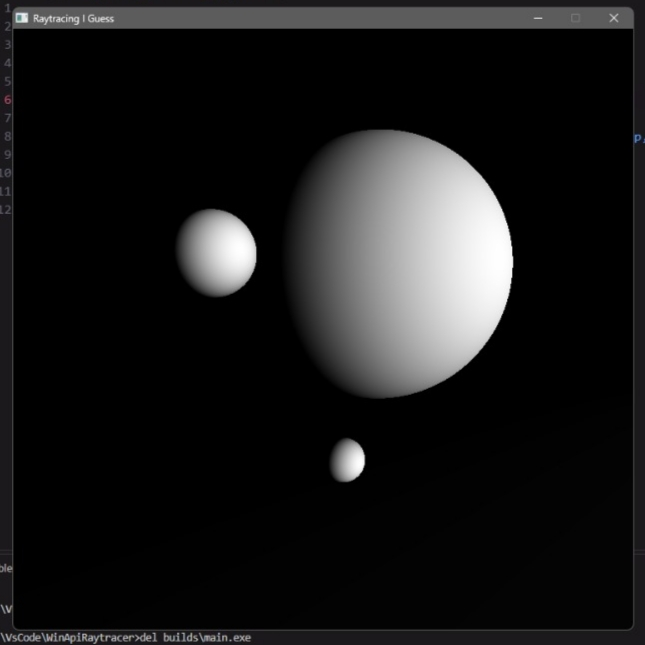

# RayTracerInCpp
**Some Spheres And Lights — Make them Shinieee!!**

A zero-dependency CPU ray tracer written from scratch in C++ using raw Win32 API. No OpenGL, no Vulkan, no third-party math libraries—just raw pointer math, quaternion rotations, and pixels pushed directly to a Windows bitmap.

## Requirements
* A computer that works and runs Windows
* `g++` (MinGW)

## Compilation Modes
There are two rendering modes controlled via compiler flags:
* `-DSINGLE` -> Only 1 CPU thread and works slow `:((`
* `-DMULTI` -> Spawns as many threads as set in `settings.h` AND WORKS FAST `:)))`

## What This Program Does & How
Basically, it shoots rays from the camera through the viewplane into infinity. If a ray hits a sphere, it checks how closely the surface normal aligns with the sun's rays and decides how bright that pixel should be.

## How to Use
* `build.bat` -> Deletes the old `.exe` and compiles a fresh one.
* `run.bat` -> Only executes the already built `.exe`.
* `brun.bat` -> Builds and runs it right away. You got the point, yea.

## Program Lifecycle

**Startup:**
`Configures Window` -> `Creates Window` -> `RInitRenderer` -> `InitWorld` (`InitCamera` -> `InitSun` -> `Start`) -> `Main Loop`

**Main Loop:**
`Update` -> `RRenderScreen` -> *(repeat)*

### What Function Does What?
* `RInitRenderer`: Creates the Win32 `BITMAPINFO` structure so we can actually draw pixels.
* `InitWorld`: Creates the Camera, creates the Sun, and locks the cursor to its place.
* `InitCamera`: Sets up camera position, rotation (quaternions), FOV, and calculates pixel steps to scale the viewplane to resolution.
* `InitSun`: Creates the sun.
* `Start`: The safe zone where you can set up your scene and not break anything at the same time.
* `Update`: Same safe zone, **BUT RUNS EVERY FRAME**.
* `RRenderScreen`: Casts rays for every pixel against all world objects and shades them based on the sun. Does the exact same thing in `-DMULTI`, just way faster across multiple threads.

## Tweaking & Spawning Objects
* **Config:** Want to change resolution, thread count, or settings without breaking the engine? `settings.h` got your back.
* **Spawning:** Call `Object::CreateObj(position, rotation, scale, isActive, OBJEXTRAARGS...)` and it spawns.

> **HARD LIMIT:** Only **128 objects** are allowed in the world at the same time! Camera and Sun live in the same object array, so you practically get **126** slots for your spheres.
